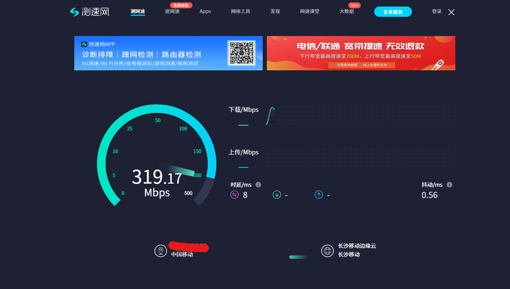

# 🏫 湖南城市学院校园网自动认证神器 v2.0

> 一个跑在电脑上的 Python 小脚本：**自动探测校园网掉线 → 自动盲刷认证 → 自动保活**。
> 配合刷好 OpenWrt 的路由器做**多线多拨**，把校园网 **100M 单线上限** 叠加到 **300M+**。



> 实测：校园网单条线路限速 100M，三线多拨 + 本脚本保活后，下行 **319.17 Mbps**（时延 8ms / 抖动 0.56ms）。

---

## 📖 目录

- [它解决什么问题](#-它解决什么问题)
- [⚠️ 动手前请确认前提条件](#️-动手前请确认前提条件)
- [🚀 快速开始（3 步）](#-快速开始3-步)
- [🎮 日常使用](#-日常使用)
- [⚙️ 配置说明](#️-配置说明)
- [🛠 多拨路由器怎么配](#-多拨路由器怎么配)
- [🧠 脚本是怎么工作的](#-脚本是怎么工作的)
- [❓ 常见问题 FAQ](#-常见问题-faq)
- [📁 项目结构](#-项目结构)
- [🧪 跑测试](#-跑测试)
- [🆕 2.0 更新了什么](#-20-更新了什么)
- [⚠️ 免责声明](#️-免责声明)

---

## 💡 它解决什么问题

校园网的认证是**按线路**的：路由器多拨出几条虚拟线路，每条都要单独登录一次，
而且登录状态会掉（断线重连、设备数超限、网关踢人……）。

一旦某条线路掉线，走这条线的流量就会被网关劫持到登录页 —— 表现为
「网页能打开但一直跳认证页」「下载一半断了」「游戏疯狂掉线」。

手动登录的痛点是：**你根本不知道是哪条线掉了**，而且多拨之后浏览器打开登录页，
很可能又认证到了另一条线上，来回折腾。

这个脚本做的事很简单也很暴力：

```
每隔一会儿探测一次网络
      │
      ├─ 正常访问到外网 ──────────► 什么都不做，继续探测
      │
      └─ 被重定向到校园网网关 ────► 拿一个账号，直接 POST 登录接口「盲刷」
                                    （多拨环境下，请求落到哪条线就认证哪条线，
                                      多刷几次就把所有线路补齐了）
```

配合**账号顺序轮换**（一个账号认证成功就换下一个，绝不回头复用），
就能让 N 条线路长期稳定在线 —— 这才是速度能叠加的前提。

---

## ⚠️ 动手前请确认前提条件

**这个脚本只负责「认证保活」，不负责「多拨」本身。** 想跑到 300M+，你需要：

| 条件 | 说明 | 必需？ |
|------|------|--------|
| **刷好 OpenWrt 的路由器** | 支持多拨（mwan3 / 多 WAN / macvlan），能拨出 2~4 条独立线路 | ✅ 多拨必需 |
| **2~4 个校园网账号** | 同一账号**同时只能认证两台设备**，线路数 ≤ 账号数 × 2 才稳；一条线一个账号最省心 | ✅ 多拨必需 |
| **一台常开的设备跑脚本** | Windows 电脑 / 小主机 / 软路由 / 树莓派都行，本仓库自带 Windows 一键启动 | ✅ |
| 校园网允许一人多号 | 学校政策自己确认，别违规 | ✅ |
| Python 3.8+ | 只有跑脚本的机器需要 | ✅ |

> 💡 **只想单线保活、不搞多拨？** 也可以。脚本照样能用，只是速度还是 100M ——
> 它解决的是「掉线要手动登录」的烦人问题，不是「带宽限制」本身。

> 💡 **只有 1 个账号？** 也能跑，但多拨时几条线会互相顶号（一个账号只能挂两台设备），
> 表现是「拨号成功但总有线路未认证」。多拨场景强烈建议**一账号一线**。

---

## 🚀 快速开始（3 步）

### 0. 下载

```bash
git clone https://github.com/Xiaowu-Niko/hncu-campus-net-keeper.git
cd hncu-campus-net-keeper
```

> 不会用 git？点页面右上角绿色 **Code** → **Download ZIP**，解压到任意目录即可。
> 整个文件夹**放哪都行**，所有路径都是相对脚本自身位置解析的，不用改任何路径。

### 1. 装依赖

```bash
pip install -r requirements.txt
```

> 只有 `requests` 一个依赖。如果提示找不到 pip，先装 Python：
> <https://www.python.org/downloads/>（安装时**勾选 Add python.exe to PATH**）。

### 2. 填配置

把 `config.example.json` **复制一份**，改名成 `config.json`，然后编辑里面的账号：

```json
{
  "accounts": [
    { "username": "13800000001", "password": "你的密码1", "isp": "local" },
    { "username": "13800000002", "password": "你的密码2", "isp": "local" },
    { "username": "13800000003", "password": "你的密码3", "isp": "local" }
  ]
}
```

- 想用几个账号就写几个，脚本按**书写顺序**轮换。
- `config.json` 已被 `.gitignore` 忽略，**不会被提交**，放心填真实账号。
- 其余字段用默认值即可，想微调见 [配置说明](#️-配置说明)。

### 3. 启动

**Windows：** 双击 `start_keeper.bat`

**Linux / macOS / 软路由：**

```bash
python3 campus_network_keeper.py
```

看到这样的输出就成功了：

```
🚀 校园网盲刷保活脚本已启动 (v2.0)
   配置文件: /path/to/config.json
   网关 IP : 172.27.99.4
   账号数量: 3（顺序轮换：认证成功即换下一个）
   账号顺序: 13800000001 -> 13800000002 -> 13800000003
```

---

## 🎮 日常使用

### Windows 一键脚本

| 命令 | 作用 |
|------|------|
| `start_keeper.bat` | **后台静默启动**（无窗口），崩溃自动重启 |
| `start_keeper.bat /stop` | 停止保活进程 + 守护进程 |
| `start_keeper.bat /restart` | 重启 |
| `start_keeper.bat /status` | 看进程状态、系统代理、最近日志 |
| `start_keeper.bat /check` | **体检**：检查配置 + 探测当前线路是否在线 |
| `start_keeper.bat /visible` | 前台运行（看实时日志，Ctrl+C 停止） |
| `start_keeper.bat /help` | 帮助 |

> 后台模式没有窗口，想看它在不在？`start_keeper.bat /status`，或者看 `campus_network_keeper.log`。

### 命令行参数

```bash
python campus_network_keeper.py              # 前台常驻（Ctrl+C 退出）
python campus_network_keeper.py --once       # 只跑一轮探测就退出（排查用）
python campus_network_keeper.py --check      # 只体检，不做任何登录
python campus_network_keeper.py --verbose    # 输出 DEBUG 级详细日志
python campus_network_keeper.py --config 另一个配置.json
python campus_network_keeper.py --version
```

### 开机自启（可选）

脚本本身**不写计划任务**（保持干净）。需要开机自启就自己加一个：

1. Win + R → `taskschd.msc` → 创建基本任务
2. 触发器：**登录时**
3. 操作：启动程序 → 选择 `start_keeper.bat` 的完整路径
4. 勾选「不管用户是否登录都要运行」更稳

---

## ⚙️ 配置说明

`config.json` 全部字段（**不写的字段自动用默认值**）：

| 字段 | 默认值 | 说明 |
|------|--------|------|
| `gateway` | `172.27.99.4` | 校园网认证网关 IP。**别的学校要改成你们自己的** |
| `login_path` | `/api/account/login` | 登录接口路径 |
| `csrf_path` | `/api/csrf-token` | CSRF Token 接口路径 |
| `session_path` | `/api/r/default` | 建立线路会话的入口 |
| `probe_urls` | 百度 / QQ / 小米 204 | 探测地址，**第一个通就算在线**；被重定向到 `gateway` 就算掉线 |
| `accounts` | `[]` | 账号列表，按顺序轮换。每项 `{username, password, isp}` |
| `field_username` | `username` | 登录表单里用户名的字段名 |
| `field_password` | `password` | 登录表单里密码的字段名 |
| `form_fields` | `{"nasId":"1","isp":"local","timeLimit":""}` | 表单里其它固定字段 |
| `probe_count_per_round` | `35` | 每轮探测次数（多拨线路多，就调大一点） |
| `sleep_after_login` | `10` | 登录成功后等几秒再继续（给网关反应时间） |
| `sleep_between_rounds` | `[60, 100]` | 两轮之间随机休眠的秒数区间 |
| `request_timeout` | `5` | 单次请求超时（秒） |
| `ip_cooldown_seconds` | `45` | 同一线路 IP 登录后的冷却，避免重复打 |
| `force_direct_connection` | `true` | **强制直连，忽略系统代理**（强烈建议保持 true） |
| `log.enabled` | `true` | 是否写日志文件 |
| `log.file` | `campus_network_keeper.log` | 日志文件名（相对脚本目录） |
| `log.level` | `INFO` | `DEBUG` 看细节，`INFO` 日常 |
| `log.max_lines` | `300` | 日志只保留最近 N 行，不会撑爆磁盘 |

### 怎么改成自己学校的

1. 浏览器打开校园网登录页，**F12 → Network**，勾上 `Preserve log`
2. 手动登录一次，找到那个 POST 请求
3. 对照填：请求 URL → `login_path`；表单里的字段名 → `field_username` / `field_password` / `form_fields`
4. 在 `Probe` 里找一下 `csrf-token` 之类的请求 → 填 `csrf_path`
5. 网关 IP 就是登录页的 IP（浏览器地址栏里那个）

> 不同学校的认证系统差别很大（锐捷 / 深澜 / Dr.COM / 城市热点……）。
> 本仓库适配的是**湖南城市学院**的网关，接口结构写在上面，改起来不难。

---

## 🛠 多拨路由器怎么配

脚本只做认证，**多拨是路由器的事**。给出我校这套的要点（OpenWrt）：

1. **多拨**：装 `mwan3`（或 `multiwan`），用 macvlan 在同一个物理 WAN 上虚拟出多个接口，
   每个接口独立 PPPoE 拨号 → 得到多个公网/内网 IP。
2. **负载均衡**：`mwan3` 里把每条线路加进同一个 `balance` 策略，按 `weight` 分流。
   建议 `sticky_time` 设长一点（比如 600s），否则同一会话来回跳线容易断。
3. **防火墙 / NAT**：每个 WAN 接口都要在 `wan` 区域，确保 MASQUERADE 生效。
4. **DNS**：交给 dnsmasq 或 smartdns 统一解析，别让某条线路的 DNS 拖慢整体。
5. **账号分配**：**一条线配一个校园网账号**。因为同一账号同时只能认证两台设备，
   多条线共用一个账号会互相顶掉。

> 📌 **测速必须多线程！** 单线程测速（很多网页测速默认单线程）永远只能跑满一条线 ≈ 100M。
> 用 Speedtest 客户端 / IDM 多线程下载 / 测速网的多线程模式，才能看到叠加后的 300M+。

---

## 🧠 脚本是怎么工作的

```
┌──────────────────────────────────────────────────────────────┐
│                      校园网认证网关                           │
│                       172.27.99.4                            │
│   ┌────────┐   ┌────────┐   ┌────────┐                       │
│   │ 线路 1 │   │ 线路 2 │   │ 线路 3 │   每条线要单独认证     │
│   └───┬────┘   └───┬────┘   └───┬────┘                       │
└───────┼────────────┼────────────┼────────────────────────────┘
        │            │            │
   ┌────┴────────────┴────────────┴────┐
   │      OpenWrt 路由器（多拨 + mwan3）│
   └────────────────┬──────────────────┘
                    │  流量被随机分流到不同线路
              ┌─────┴─────┐
              │  你的电脑  │  ← 本脚本在这里跑
              │  keeper   │
              └───────────┘
```

核心机制：

1. **三态探测**：探测结果分三种 —— `在线` / `明确掉线（被网关劫持）` / `网络不可达`。
   只有「明确掉线」才触发登录；网络层抖动不会被误判成掉线，避免疯狂拨号把账号打挂。
2. **盲刷登录**：拿到 CSRF Token → 直接 POST 登录接口。
   多拨环境下请求落到哪条线就认证哪条线，多探测几次自然覆盖所有线路。
3. **账号顺序轮换**：认证成功一次就**永久**推进到下一个账号，绝不回头复用。
   认证失败则保留当前账号，下一轮重试 —— 避免把只是临时故障的账号跳过。
4. **强制直连**：`trust_env=False` + `proxies={}`。
   Windows 上 `requests` 会读注册表里的系统代理（常见 `127.0.0.1:7897`），
   代理一退出请求就全挂 —— 这是旧版本「进程莫名其妙消失」的真正原因。
5. **双层看门狗**：单次探测异常不影响本轮；整轮异常不影响主循环；
   进程挂了由 `keeper.ps1` 守护进程 10 秒后自动拉起。

---

## ❓ 常见问题 FAQ

<details>
<summary><b>Q：速度没有叠加，还是 100M？</b></summary>

按顺序排查：

1. **测速方式不对**（最常见）—— 单线程永远 100M，换多线程测速工具。
2. **只有一条线在认证** —— `start_keeper.bat /check` 或看日志，确认每条线都认证成功了。
3. **账号不够** —— 3 条线只有 1 个账号，最多挂 2 台设备，必然有一条空着。
4. **mwan3 分流没生效** —— 路由器上 `mwan3 status` 看每条线的状态和权重。
5. **上游本身限速** —— 有些学校的多拨是共享 100M 池，叠加无效，以实测为准。
</details>

<details>
<summary><b>Q：脚本跑着跑着就没了 / 日志不再更新？</b></summary>

2.0 已经修掉了「代理导致进程静默退出」这个坑。如果还出现：

- 看 `logs/supervisor.log`，里面会记录退出码和重启时间
- 用 `start_keeper.bat /status` 确认进程在不在
- 开着 Clash / V2Ray 等代理时，确认 `force_direct_connection` 是 `true`
</details>

<details>
<summary><b>Q：提示「无法获取 CSRF token」？</b></summary>

- 网关 IP 填错了，或者你现在根本没连校园网
- 学校换了认证系统，`csrf_path` 要按 F12 抓包重新确认
- 浏览器能打开登录页但脚本不行？把系统代理关掉再试（脚本本身已强制直连）
</details>

<details>
<summary><b>Q：账号老是被顶掉 / 提示「该账号已在别处登录」？</b></summary>

同一账号同时只能认证两台设备。多拨场景请**一条线一个账号**，
或者把 `accounts` 里的账号数加到 ≥ 线路数。
</details>

<details>
<summary><b>Q：日志在哪？怎么看得更详细？</b></summary>

- 主日志：`campus_network_keeper.log`（默认只留最近 300 行）
- 守护日志：`logs/supervisor.log`
- 想看每一步细节：把 `config.json` 里 `log.level` 改成 `"DEBUG"`，
  或运行时加 `--verbose`
</details>

<details>
<summary><b>Q：会不会被学校查到 / 封号？</b></summary>

脚本只是自动化了你本来就在做的登录动作，没有破解、没有抓包重放、没有改包。
但**多账号、多拨本身可能违反校园网使用规定**，风险请自行评估（见免责声明）。
</details>

<details>
<summary><b>Q：Linux / OpenWrt 上怎么跑？</b></summary>

```bash
pip3 install -r requirements.txt
python3 campus_network_keeper.py            # 前台
nohup python3 campus_network_keeper.py &    # 后台
```

systemd 服务示例（可选）：

```ini
[Unit]
Description=Campus Network Keeper
After=network-online.target

[Service]
Type=simple
WorkingDirectory=/opt/campus-net-keeper
ExecStart=/usr/bin/python3 /opt/campus-net-keeper/campus_network_keeper.py
Restart=always
RestartSec=10

[Install]
WantedBy=multi-user.target
```
</details>

<details>
<summary><b>Q：换了电脑 / 换了目录还能用吗？</b></summary>

能。所有路径都相对脚本自己所在的目录解析，把整个文件夹拷走就行。
唯一需要重做的是 `config.json`（它不在仓库里，得自己带过去）。
</details>

---

## 📁 项目结构

```
hncu-campus-net-keeper/
├── campus_network_keeper.py   # 主脚本（探测 + 盲刷登录 + 保活）
├── keeper.ps1                 # Windows 守护进程（自动重启、状态查询）
├── start_keeper.bat           # 双击启动的入口（调用 keeper.ps1）
├── config.example.json        # 配置模板 —— 复制成 config.json 再填账号
├── config.json                # 你的真实配置（已被 .gitignore 忽略，不会上传）
├── requirements.txt           # 依赖：requests
├── test_keeper.py             # 单元测试（不需要真实校园网）
├── LICENSE                    # MIT
├── docs/
│   └── speedtest-319mbps.png  # 实测网速截图
└── logs/                      # 运行产物（自动生成，已忽略）
    ├── supervisor.log
    ├── keeper.lock
    └── supervisor.pid
```

> 仓库里**没有任何真实账号密码**，只有占位模板。

---

## 🧪 跑测试

不需要连校园网，全部用 mock：

```bash
python -m unittest test_keeper -v
```

覆盖：代理隔离、三态探测、登录成功/失败/异常/JSON 解析失败、
账号顺序轮换（不回头、跨轮、重复条目、单账号、空列表）、
整轮健壮性、主循环看门狗、配置加载、以及**「仓库里不能出现真实手机号」的防泄露测试**。

---

## 🆕 2.0 更新了什么

| 变化 | 说明 |
|------|------|
| 🔐 **配置外置** | 账号、网关、参数全部挪到 `config.json`，代码里零个人隐私，仓库只放 `config.example.json` |
| 🐍 **Python 自动探测** | 不再写死 `C:\Users\xxx\...\python.exe`，自动找 PATH / py 启动器 / 常见安装目录，可用 `CAMPUS_KEEPER_PYTHON` 覆盖 |
| 📁 **全相对路径** | 解压到任何目录都能直接跑，换电脑、换盘符不用改一行 |
| 🩺 **`--check` 体检** | 一条命令检查配置 + 当前线路状态，不用瞎猜 |
| 🔁 **`--once` 单轮** | 只跑一轮就退出，排查问题不用等整轮 |
| 🛡 **探测三态化** | 区分「明确掉线」和「网络不可达」，后者不拨号，避免误伤账号 |
| 🔄 **账号顺序轮换** | 认证成功即换下一个、绝不回头；失败才重试同一个 |
| 🧯 **双层看门狗** | 单次探测 / 整轮 / 进程三层兜底，`keeper.ps1` 挂了自动拉起 |
| 🧪 **单元测试** | 56 个测试，含防账号泄露检查 |
| 📊 **实测数据** | 100M → 319.17 Mbps，附测速截图 |

---

## ⚠️ 免责声明

本项目**仅供学习交流与网络自动化研究**。

- 使用本工具产生的一切后果（包括但不限于账号被封、违纪处分、网络异常）由使用者自行承担。
- 请遵守所在学校的校园网管理规定，**不要**用于绕过计费、盗用他人账号或任何非法用途。
- 多账号、多拨等行为可能违反学校规定，请自行评估风险。
- 作者不对任何学校网络设备的稳定性负责。

---

## 📄 License

[MIT](LICENSE) © 2026 Xiaowu-Niko

---

⭐ 如果这个项目帮到了你，点个 **Star** 让更多被校园网折磨的同学看到！
